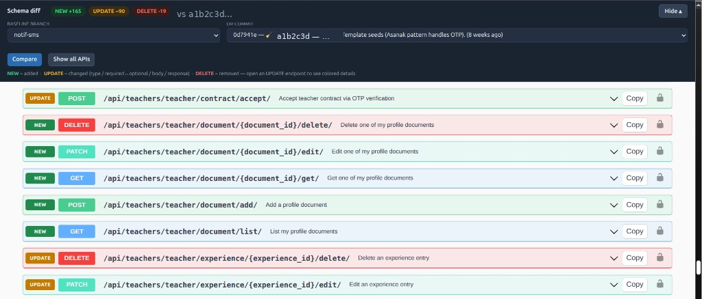

# 🔀 swagger-diff-ui

[](https://pypi.org/project/swagger-diff-ui/)
[](https://pypi.org/project/swagger-diff-ui/)
[](LICENSE)

**Drop-in Swagger UI for Django + DRF** that diffs your live OpenAPI schema against a **git branch or commit** — then paints every changed endpoint as **NEW · UPDATE · DELETE**.

No Node. No separate SPA. Same `/api/docs/` you already open — with a small baseline drawer on top.



*Pick a baseline → Compare → see what changed.*

---

## ✨ What you get

| | Feature | What it does |
|---|---------|----------------|
| 🌿 | **Branch / commit / relative ref** | Baseline from git (`main`, SHA, `HEAD~1`, …) |
| ▶️ | **Compare** | Diff current schema vs that baseline |
| 🟢🟡🔴 | **NEW / UPDATE / DELETE** tags | On the left of every changed operation |
| 🎯 | **Changed only** | Hide unchanged APIs (toggle anytime) |
| 🔬 | **Field-level UPDATE** | Params, body, responses, schema props — colored dots |
| 🧱 | **CI CLI** | `manage.py swagger_diff --ci` exits non-zero on breaking changes |

> ⚙️ Baseline export uses a temporary **git worktree** + `manage.py spectacular`. HTTP endpoints are intended for **local / DEBUG** only; the management command is safe for CI.

---

## 📦 Requirements

- Python **3.10+**
- Django **4.2+**
- Django REST Framework
- [drf-spectacular](https://drf-spectacular.readthedocs.io/)
- A **git checkout** of your project (for branch/commit baselines)

---

## 🚀 Install

```bash
pip install swagger-diff-ui
```

### From GitHub

```bash
pip install "git+https://github.com/Iman-Sharei/swagger-diff-ui.git"
```

---

## 🔌 Wire into Django

Same idea as spectacular: **one app + a few routes**.

### 1️⃣ Add the app

```python
# settings — typically local / debug only
INSTALLED_APPS = [
    # ...
    "drf_spectacular",
    "swagger_diff_ui",
]
```

### 2️⃣ Keep spectacular’s schema + include our URLs

```python
# urls.py
from django.urls import include, path
from drf_spectacular.views import SpectacularAPIView

urlpatterns = [
    # Real OpenAPI document (unchanged)
    # ⚠️ URL name MUST be "api-schema" (or set SWAGGER_DIFF_SCHEMA_URL_NAME)
    path("api/schema/", SpectacularAPIView.as_view(), name="api-schema"),

    # Diff UI + helpers
    path("api/", include("swagger_diff_ui.urls")),
]
```

The Swagger view resolves the schema via Django’s URL name **`api-schema`**. If your project uses a different name, either rename it or set:

```python
SWAGGER_DIFF_SCHEMA_URL_NAME = "my-schema"  # must match SpectacularAPIView's name=
```

### 3️⃣ Open the docs

```text
http://127.0.0.1:8000/api/docs/
```

Done. ✅

---

## 🖱️ How to use

1. Open **`/api/docs/`**
2. In the dark drawer, pick a **baseline branch** or **commit**
3. Click **Compare**
4. Changed endpoints get **NEW / UPDATE / DELETE**
5. Open an **UPDATE** row for field-level diffs + colored Example Value dots
6. Use **Changed only** / **Show all APIs** and **Hide ▴** / **Show ▾**

Git refs accept **branch names**, **SHAs**, and **relative history** forms such as `HEAD~1`, `main~3`, or `HEAD^`.

⏱️ First compare for a given SHA can take a bit (worktree + schema export). Results cache under `.schema-cache/` — keep that folder in `.gitignore`.

---

## 🧱 CI / CLI (breaking changes)

Run inside your Django project (same env as `manage.py`):

```bash
# Diff current schema vs previous commit; fail CI if breaking
python manage.py swagger_diff --ref HEAD~1 --ci

# Machine-readable report
python manage.py swagger_diff --ref origin/main --format json

# Fail only when you ask
python manage.py swagger_diff --ref HEAD~1 --fail-on-breaking
```

| Flag | Meaning |
|------|---------|
| `--ref` | Baseline git ref (default `HEAD~1`) |
| `--format text\|json` | Human summary or full JSON report |
| `--fail-on-breaking` | Exit `1` when breaking changes exist |
| `--ci` | Shorthand: text summary + fail on breaking |
| `--no-cache` | Skip `.schema-cache` and regenerate baseline |

Breaking detection is **heuristic** (removed operations/params/fields, newly required request fields, type/`$ref` changes, removed enum values, …). Use it as a CI gate, not a formal compatibility proof.

Example GitHub Actions step:

```yaml
- name: OpenAPI breaking change check
  run: python manage.py swagger_diff --ref origin/${{ github.base_ref }} --ci
```

---

## 🗺️ Routes

Assuming you included under `api/`:

| URL | Role |
|-----|------|
| `/api/docs/` | Swagger UI + schema-diff drawer |
| `/api/schema/` | Your real OpenAPI schema (**spectacular**, name=`api-schema`) |
| `/api/swagger-diff/git-refs/` | Branches + recent commits |
| `/api/swagger-diff/diff/?ref=…` | Diff report vs baseline |
| `/api/swagger-diff/baseline/?ref=…` | Raw baseline OpenAPI (optional) |

Diff helpers live under `/api/swagger-diff/…` so they never collide with `/api/schema/`.

---

## ⚙️ Settings & environment

| Knob | Default | Purpose |
|------|---------|---------|
| `DJANGO_SETTINGS_MODULE` | *(required in real apps)* | Used when exporting baseline schemas in a git worktree |
| Fallback if unset | `config.settings.local` | Cookiecutter-style default for baseline subprocesses |
| `SWAGGER_DIFF_SETTINGS_MODULE` | — | Override settings module for baseline export only |
| `SWAGGER_DIFF_SCHEMA_URL_NAME` | `api-schema` | URL name passed to Swagger UI for the live schema |

If your Django settings live elsewhere (e.g. `myproject.settings.dev`), set `DJANGO_SETTINGS_MODULE` as usual — or set `SWAGGER_DIFF_SETTINGS_MODULE` when the baseline worktree should load a different module than the running process.

---

## 🔒 Safety notes

- Git baseline **HTTP** APIs are gated to **`DJANGO_ENV == "local"`** or **`DEBUG=True`**
- The **`swagger_diff` management command** skips that gate so CI can run with `DEBUG=False`
- Do **not** expose the HTTP helpers on production with `DEBUG=True`
- Prefer wiring `swagger_diff_ui` only in local / staging settings (CLI can stay available wherever `INSTALLED_APPS` includes the package)

---

## 🧪 Develop & test

```bash
pip install -e ".[dev]"
pytest -q
```

---

## 📄 License

[MIT](LICENSE) · made for Django + DRF teams who live in `/api/docs/`
